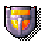
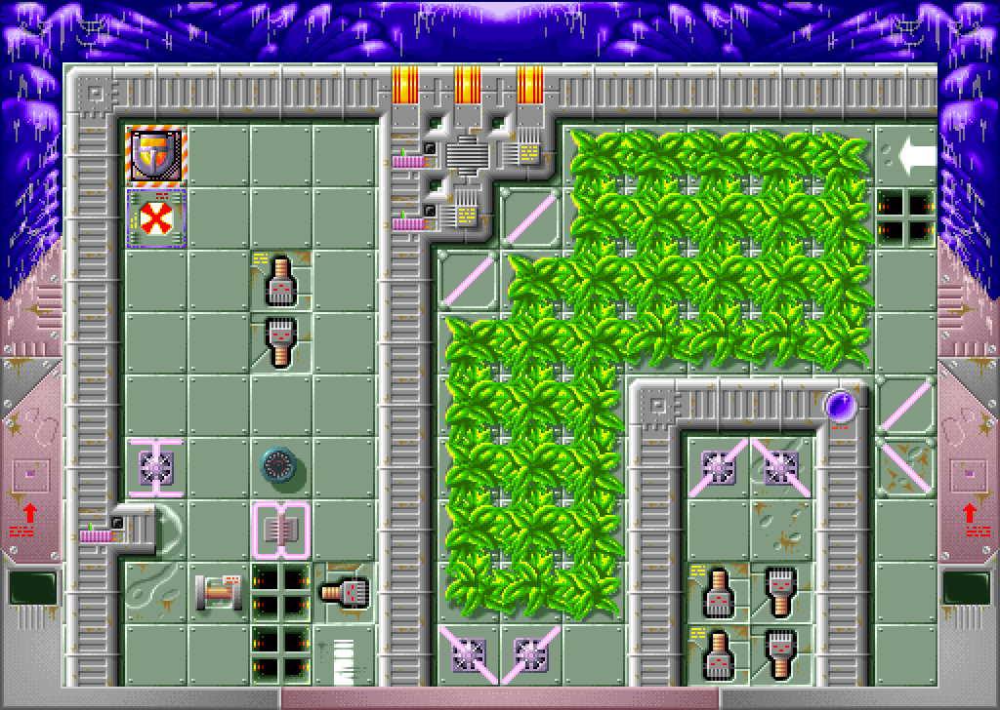

#  S.C.Out
Old arcade/strategy game http://en.wikipedia.org/wiki/S.C.OUT

# About this project
Ouro S.C.Out: a new implementation of S.C.Out in Rust, for macOS, Windows and Linux.
The game data comes from the original Mac version (1993):
`ouro-scout-extract` converts the original disk image `SCOUT_1_4.dsk` into a
data pack, `data/ouro-scout-data.zip` (PNG, WAV, FLAC and text), which is
built into the game. The gameplay should stay as close to the original as possible,
with optional modern extensions.

Part of *MetalSnake's Classic Mac Ports*; "Ouro" (from Ouroboros) is the
name of these ports: the old game in a new skin.

Work in progress, see [TODO.md](TODO.md).

## Installing
With [Homebrew](https://brew.sh) (macOS, Linux):

    brew install metalsnake-classic-mac-ports/games/ouro-scout
    ouro-scout

## Building
You need Rust (via [rustup](https://rustup.rs)) and SDL3
(macOS: `brew install sdl3`). Then:

    cargo test
    cargo run --release -p scout

`ouro-scout` plays the game: logo, title and menu (Play, Password, Settings,
About, Quit), levels, music and sound. Default keys: arrows move, Return
takes / drops, Space fires, Esc blows yourself up (as in the original);
Command (or Ctrl) + P pauses, + Q quits, F11 or Command (or Ctrl) + F
switches to full screen. The game pauses when its window loses the focus.
The keys can be changed in the settings, which are saved in SDL's
preference folder (macOS: `~/Library/Application Support/Ouro S.C.Out`).
A data pack on the command line, in `SCOUT_DATA`, or as
`ouro-scout-data.zip` beside the program or in the current folder replaces
the built-in one. `--dev` adds keys for
development: N/P next/previous level, R restart, Tab level map, F1 palette.
`ouro-scout DATA --export LEVEL out.bmp [screen|map|level] [PALETTE]` writes a
level as an image, `ouro-scout DATA --export-menu PAGE out.bmp` a menu page.

The tests that need the original disk (crate `scout-original`) look for it at
`re/work/SCOUT_1_4.dsk` and are skipped without it.

## Folders
- `crates/scout-core/`: game model and simulation, no I/O
- `crates/scout-data/`: the game data and the data pack the game reads
- `crates/scout-original/`: reads the original (HFS disk image, resource fork,
  LZRW1-A, PICT, palettes, sounds, the music player of CODE 10), writes the
  data pack; the tool `ouro-scout-extract` and the tests against the original
- `crates/scout/`: the SDL3 frontend
- `data/ouro-scout-data.zip`: the game data, made with
  `ouro-scout-extract --only pack re/work/SCOUT_1_4.dsk data`
- `CHANGELOG.md`: what changed in each version; `TODO.md`: what is still to do
- `NOTES.md`: how the original works, from the analysis of its 68k code
- `BUGS.md`: bugs and oddities of the original and how the rewrite
  treats them
- `ouro-scout-extract [OPTIONS] [DISK] OUT_DIR` (crate `scout-original`): exports graphics
  (PNG, single and/or sheets), sounds (WAV), the music and its unused earlier version
  (ProTracker `.mod` and WAV), levels (text and/or pictures of the whole
  level), level codes and the palette as the game reads them, and the data pack
  `ouro-scout-data.zip` (`--only pack`: everything the game needs in ordinary formats; the
  music rendered with the bugs of the original player fixed, or with `--music original`
  as the original plays it); `--help` lists the options. Install it with
  `cargo install --path crates/scout-original`; with `SCOUT_DISK`
  set to the disk image it works from any folder, e.g.
  `ouro-scout-extract --only level-images ~/scout-levels`
- `re/tools/`: tools to read and unpack the resources of the original game

## Credits
S.C.Out © 1992 Atreid Concept, published by Kalisto. Program: Mathieu
Marciacq; Mac version: Fabrice Armisen; graphics: Stephan Renaudin; sound
effects: Olivier Bailly-Maître; music: Fred Motte; compression: Ross
Williams (LZRW1-A). The game data in `data/` is theirs; this project is not
affiliated with them.

Paul Mercat's C++ port (2008, http://mercat.jean.free.fr/S.C.Out/) was the
starting point of this project; it is in the git history before 2026-10-22.
